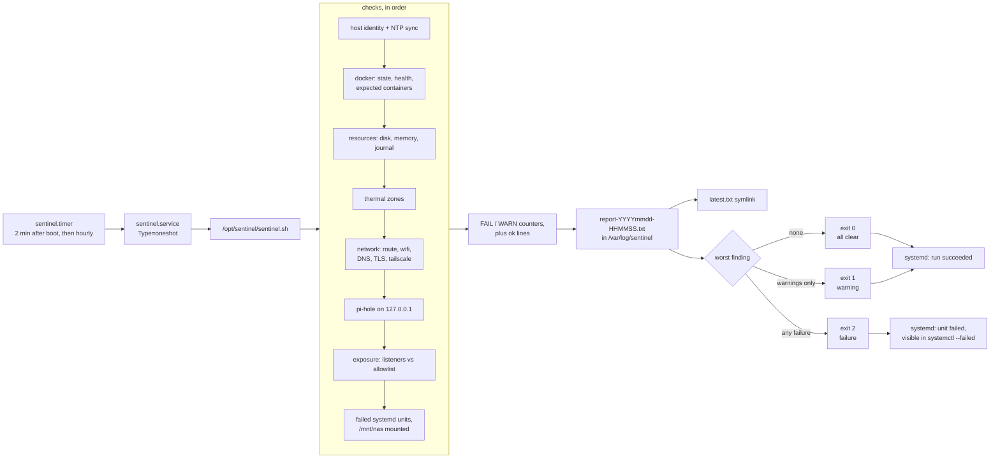

# homelab-sentinel

A single-file health check for one self-hosted Linux box, meant to run hourly from a systemd
timer. Every run writes a timestamped plain-text report and exits with a graded status:
`0` all clear, `1` warnings, `2` failures.

It is deliberately narrow. The script encodes the expectations of one specific host — a
Docker media stack, Pi-hole on loopback, a NAS mount — and is published as a worked example
to adapt, not as a drop-in monitoring product. It reports; it does not alert. Something has to
read the report or look at the exit status.

## How a run works



## What it checks

| Area | Check | Result when it trips |
|---|---|---|
| Clock | `timedatectl` NTP synchronised flag | **FAIL** — skew breaks TLS validation |
| Docker | running/exited counts printed; unhealthy or restart-looping containers named | **FAIL** |
| Expected containers | running containers matched by exact name: `pihole`, `jellyfin`, `qbittorrent`, `prowlarr`, `jackett`, `jellyseerr`, `filebrowser` | **FAIL** per missing container |
| Root filesystem | `df` on `/` | **WARN** at ≥80%, **FAIL** at ≥90% |
| Memory | available MB from `free -m` | **WARN** below 1024 MB |
| Journal | `journalctl --disk-usage` | **WARN** at ≥1.0 G |
| Thermals | every `/sys/class/thermal/thermal_zone*` | **FAIL** at ≥90 °C |
| Routing | default route and interface | printed, not graded |
| Wi-Fi | signal and bitrate, only when the default route is a `wl*` interface | **WARN** weaker than −70 dBm |
| Name resolution | `getent hosts www.google.com` | **FAIL** |
| HTTPS | `curl -fsS -m 8 https://www.google.com` | **FAIL** — covers clock, trust store, egress |
| Tailscale | `tailscale status` | **WARN** only |
| Pi-hole | `dig @127.0.0.1 cloudflare.com` | **FAIL** if the local resolver does not answer |
| Exposure | TCP listeners on `0.0.0.0` / `[::]` outside the allowlist | **WARN** for listeners new since the previous run |
| systemd | `systemctl --failed` | **FAIL** if anything is failed |
| Storage | `/mnt/nas` is a mountpoint | **WARN** |

Load average and the per-container status list are printed for context but not graded.

## Exit codes

| Code | Meaning | Effect under systemd |
|---|---|---|
| `0` | every check passed | unit succeeds |
| `1` | at least one warning, no failures | unit succeeds, because the unit sets `SuccessExitStatus=0 1` |
| `2` | at least one failure | unit enters `failed`, so `systemctl --failed` surfaces it |

Exit `1` collides with the usual "generic error" convention, so treat the code as
"0 clean / 1 degraded / 2 broken" rather than pass/fail.

The `SuccessExitStatus=0 1` line is the point of the graded codes: a permanently absent
media drive produces a warning every hour, and without it the monitor's own
"no failed units" check would flag `sentinel.service` and mask real failures.

A run that exits `2` leaves the unit in `failed` state. Inspect and fix the underlying
cause; clear a lingering failed state when necessary:

```bash
sudo systemctl reset-failed sentinel.service
```

## Requirements

Linux with systemd — the script reads `/proc` and `/sys` and calls `systemctl`,
`journalctl`, `timedatectl`. It does not run on macOS or BusyBox.

- `bash` (indexed arrays are used; unlike associative arrays, they do not require bash 4)
- GNU coreutils (`df --output`), `procps` (`free`), util-linux (`mountpoint`)
- `iproute2` (`ip`, `ss`), plus `awk`, `sed`, `grep`, `comm`
- `docker` CLI with access to the daemon
- `dig` (dnsutils / bind-utils), `curl`, `getent`
- optional: `iw` for the Wi-Fi checks, `tailscale` CLI for the VPN check
- root, because the report directory lives under `/var/log` (`ss -p` also needs privileges
  to resolve process names, though the listener check only prints addresses)

There is no additional language runtime beyond Bash, and no config file. Settings are edited in the script.

## Before you deploy

> **This script is tuned to one host.** On any other machine it will produce failures for
> things you never had. Read the checks against your own setup before wiring it to a timer,
> and change the expectations rather than the thresholds.

Hardcoded assumptions, and where they live:

| Setting | Value in the script | Change when |
|---|---|---|
| Report directory | `OUT_DIR=/var/log/sentinel` | `/var/log` is not where you keep run reports |
| Expected containers | `for c in pihole jellyfin qbittorrent prowlarr jackett jellyseerr filebrowser` | your stack has different names |
| Local resolver | `dig … @127.0.0.1` | DNS does not run on this host |
| NAS mount | `mountpoint -q /mnt/nas` | your data drive is elsewhere |
| Disk thresholds | warn 80%, fail 90% on `/` | your root volume is sized differently |
| Memory warning | <1024 MB available | you run tighter or looser than that |
| Journal warning | ≥1.0 G on disk | you keep longer or shorter history |
| Thermal failure | ≥90 °C | your SoC throttles earlier or later |
| Wi-Fi warning | weaker than −70 dBm | your link budget differs |
| Exposed-port allowlist | `22 53 80 443 5055 6881 8081 8082 8096 9117 9696 8080 2222` | you expose different services |

Two operational notes:

- **Run it as root, and confirm a report file appeared.** If `/var/log/sentinel` exists but
  is not writable, the shell cannot open the report, so none of the checks run and the
  script still exits `0` with no output. `ls -l /var/log/sentinel/latest.txt` after the
  first run is the real install check.
- **It reaches the public internet.** The TLS and DNS checks request `www.google.com`, and
  `tailscale status` talks to the local daemon. Adjust if that is not acceptable on the host.

## Quick start

Paths below assume `/opt/sentinel`; change them consistently in the unit if you put it
elsewhere.

```bash
sudo install -d -m 755 /opt/sentinel
sudo install -d -m 755 /var/log/sentinel
sudo install -m 755 sentinel.sh /opt/sentinel/sentinel.sh
sudo install -m 644 README.md  /opt/sentinel/README.md
```

`/etc/systemd/system/sentinel.service`:

```ini
[Unit]
Description=homelab-sentinel health check
Documentation=file:/opt/sentinel/README.md
Wants=network-online.target
After=network-online.target docker.service

[Service]
Type=oneshot
ExecStart=/opt/sentinel/sentinel.sh
# 0 = clean, 1 = warnings. Exit 2 is a real failure and should fail the unit.
SuccessExitStatus=0 1
```

`/etc/systemd/system/sentinel.timer`:

```ini
[Unit]
Description=Run homelab-sentinel hourly

[Timer]
OnBootSec=2min
OnUnitActiveSec=1h
AccuracySec=1min
Unit=sentinel.service

[Install]
WantedBy=timers.target
```

```bash
sudo systemctl daemon-reload
sudo systemctl enable --now sentinel.timer
```

`ExecStart` has no `--quiet`, so the report is also copied into the journal. Add `--quiet`
if you only want the file and the exit code.

The timer is monotonic: it does not replay runs missed while the host was off. Use
`OnCalendar=hourly` with `Persistent=true` if you want catch-up runs instead.

### Verify the install

```bash
systemctl list-timers sentinel.timer          # next elapse
sudo systemctl start sentinel.service         # run once now
journalctl -u sentinel.service -n 40 --no-pager
ls -l /var/log/sentinel/
```

The first run is expected to report problems on a host that does not match the assumptions
above. That is the script working, not failing.

## Usage

```bash
sudo /opt/sentinel/sentinel.sh            # run, print the report, write the file
sudo /opt/sentinel/sentinel.sh --quiet    # write the file only
```

`--quiet` is only recognised as the first argument. The exit code is the result:

```bash
sudo /opt/sentinel/sentinel.sh --quiet; echo "exit=$?"
```

A manual run starts or stops no services, edits no configuration, and
touches no firewall. Its only writes are its own artefacts under `/var/log/sentinel` and a
scratch file at `/tmp/sentinel-listeners.new`.

## Output

| Path | Contents |
|---|---|
| `/var/log/sentinel/report-YYYYmmdd-HHMMSS.txt` | full report: host header, one section per check area, `SUMMARY` with counts, then one `FAIL` / `WARN` / `ok` line per finding |
| `/var/log/sentinel/latest.txt` | symlink to the newest report |
| `/var/log/sentinel/state-listeners.txt` | listener set from the previous run; the baseline for the "new listener" warning. Delete it to re-baseline |
| `/tmp/sentinel-listeners.new` | scratch file for the listener diff, moved into place each run |

Reports are plain text, so they `diff`, `grep`, and attach to a bug report cleanly. Stderr
from the individual tools is captured into the report too.

## Limitations

- No alerting: no mail, webhook, or pager. Exit status plus a text file is the whole interface.
- If the Docker daemon is down, every expected container is reported missing individually
  rather than once as "docker unavailable", so one outage looks like seven failures.
- The `sonarr` / `radarr` "parked on purpose" warning branch is currently unreachable —
  neither name is in the expected-container list.
- The journal check only understands gigabyte output (`1.0G`), not MB or TB.
- The Pi-hole check only asks whether `dig` got an answer at all — its output is discarded,
  so a resolver replying `SERVFAIL` or with an empty answer can still pass.
- No SMART, backup-age, certificate-expiry, or throughput checks. Load average is displayed
  but never graded.
- Single host, no inventory, no history beyond the report files themselves.

## Design notes

- Deterministic checks only. Anything that needs judgement is left to whatever reads the
  report, which keeps two runs against the same host state comparable.
- One report per run plus a `latest` symlink; no database, no rotation policy.
- Findings are recorded through `fail` / `warn` / `ok` helpers so the `SUMMARY` block always
  matches the sections above it.
- `set -uo pipefail` without `-e`: a single broken tool should degrade one check, not abort
  the run before the summary.

## Contributing

See [CONTRIBUTING.md](CONTRIBUTING.md).
